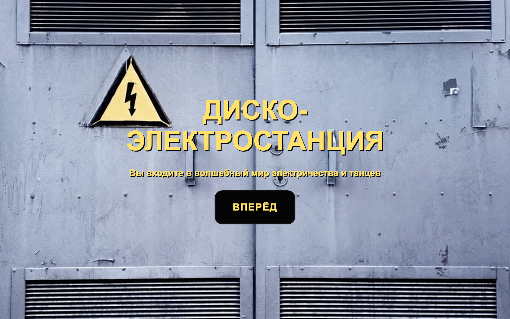

# Диско-электростанция

Одностраничный сайт-концепт вымышленной вечеринки «Диско-электростанция» в трансформаторном цехе 3030 года. Танцующие вырабатывают электричество через пьезопол, а накопленная за ночь энергия утром зажигает городские фонари. Сайт сделан на HTML и CSS, без JavaScript.

## Ссылка на сайт

https://fisazzz.github.io/Disco-toque/

Репозиторий: https://github.com/Fisazzz/Disco-toque

## Скриншот

## Автор

Захарова Анфиса, 2 группа

Сайт сделан целиком одним автором: идея и тексты концепта, дизайн, вёрстка всех четырёх страниц (обложка, пульт «Пуск», «Концепт», «Как попасть»).

## Что я научилась делать

- Верстать одностраничный сайт с навигацией по якорям (`#start`, `#panel`, `#concept`, `#party`) и плавной прокруткой.
- Разделять стили по файлам (`reset.css`, `fonts.css`, `layout.css`, `style.css`) и подключать их в правильном порядке.
- Делать анимации только на CSS: мерцание значков через `@keyframes` и переключение экранов через `:target`.
- Публиковать сайт на GitHub Pages и проверять, что он открывается.
- Было трудно: после публикации пропала обложка. Оказалось, что на GitHub Pages регистр букв в имени файла важен: в CSS было `cover.jpg`, а файл назывался `cover.JPG`. На Mac это работало, на сервере нет. Теперь проверяю, что имена файлов в коде совпадают с реальными буква в букву.

## Использование ИИ

### Инструменты

| Инструмент | Для чего использовала | Уровень помощи |
|------------|-----------------------|----------------|
| Claude (Anthropic) | Написал основной файл стилей, секции «Концепт» и «Как попасть», пульт «Пуск», мерцание значков, металлический шильдик, заполнение индикатора энергии | 3 |
| Claude (Anthropic) | Нашёл, почему пропала обложка на опубликованном сайте; убрал из репозитория лишние и неиспользуемые файлы; помог оформить этот README | 2 |

Места в коде, где помогал ИИ, помечены комментарием «ИИ: …» с номером записи.

### Записи о запросах

#### Запись №1 · [дата]
- **Что я хотела сделать:** чтобы у сайта был единый файл стилей: цвета, рамки, анимации.
- **Что я спросила:** [скопировать свой главный вопрос к ИИ]
- **Что ответил ИИ:** помог написать общий файл `stylesheets/style.css`.
- **Что я изменила сама:** поменяла цвета и отступы под свой дизайн, остальное переименовала по-своему.
- **Как я поняла, что это работает:** открыла страницу в браузере, прокрутила все четыре экрана, сузила окно и проверила, что вёрстка не ломается.

#### Запись №2 · [дата]
- **Что я хотела сделать:** разложить тексты концепта на понятные карточки.
- **Что я спросила:** [ ]
- **Что ответил ИИ:** написал секцию «Концепт» и разбил мои тексты на четыре карточки.
- **Что я изменила сама:** поправила формулировки и порядок карточек.
- **Как я поняла, что это работает:** открыла в браузере, проверила, что карточки встают в ряд на широком экране и друг под другом на узком.

#### Запись №3 · [дата]
- **Что я хотела сделать:** страницу «Как попасть»: дни и время, расписание ночи, дресс-код, браслеты, правила цеха, место.
- **Что я спросила:** [ ]
- **Что ответил ИИ:** написал структуру секции и придумал часть текстов.
- **Что я изменила сама:** заменила придуманные тексты на свои, поправила время в расписании.
- **Как я поняла, что это работает:** сверила расписание с моими заметками и пролистала страницу в браузере.

#### Запись №4 · [дата]
- **Что я хотела сделать:** чтобы значки мерцали, а название сайта висело на металлической табличке с заклёпками.
- **Что я спросила:** [ ]
- **Что ответил ИИ:** написал мерцание квадратов и значков на `@keyframes` и металлический шильдик (блок `.plate`).
- **Что я изменила сама:** подобрала скорость мерцания и цвет металла.
- **Как я поняла, что это работает:** смотрела анимацию в браузере, пока не стало нравиться.

#### Запись №5 · [дата]
- **Что я хотела сделать:** пульт «Пуск» в виде щитка с двумя переключателями и индикатор накопленной энергии, который заполняется при прокрутке.
- **Что я спросила:** [ ]
- **Что ответил ИИ:** нарисовал пульт по моему описанию и придумал заполнение индикатора через прокрутку.
- **Что я изменила сама:** поменяла подписи переключателей на «Концепт» и «Попасть».
- **Как я поняла, что это работает:** нажимала переключатели и прокручивала страницу, смотрела, как заполняется индикатор.

#### Запись №6 · 29.10.2026
- **Что я хотела сделать:** чтобы обложка показывалась на опубликованном сайте, а не только у меня на компьютере.
- **Что я спросила:** «Что у меня не так с кодом, что картинка исчезла при финальном сохранении?»
- **Что ответил ИИ:** объяснил, что GitHub Pages различает регистр букв в именах файлов: в CSS написано `cover.jpg`, а файл называется `cover.JPG`. Предложил исправить одно слово в `stylesheets/style.css`. Заодно убрал из репозитория пустые и неиспользуемые файлы.
- **Что я изменила сама:** проверила, что все остальные ссылки на файлы совпадают с их именами.
- **Как я поняла, что это работает:** открыла опубликованный сайт и увидела обложку; в консоли браузера нет ошибок.

### Выводы

ИИ больше всего помог с анимациями на CSS и с поиском причины, почему пропала обложка: сама я бы долго не догадалась про регистр букв. Ошибок в его коде я не заметила, но тексты, которые он придумал, пришлось переписать под свою идею. Теперь я сама могу подключить стили в нужном порядке, настроить якорную навигацию и проверить сайт после публикации. Объяснить каждую строку своего кода я могу, а то, что не поняла, разбирала с ИИ отдельно.
